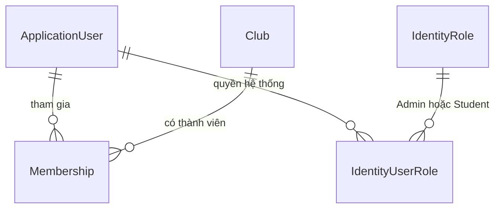

> Cập nhật 13/11/2026: PB12–PB15 đã có đăng ký, lịch sử và chốt điểm danh. PB16 thêm Announcements và AnnouncementRecipients; PB17 thêm ReadAt, bảng người nhận hiện có 3 cột. PB18 thêm SourceKey, Announcements hiện có 10 cột. Tổng cộng vẫn 12 bảng nghiệp vụ; xem [SQL thông báo](announcements.md), [đánh dấu đã đọc](notification-inbox.md), [thông báo tự động](event-change-notifications.md) và [schema hiện tại](simple-database.md). Quyền hệ thống dùng Users.RoleId → Roles, không còn UserRoles. Các phần theo ngày bên dưới ghi lại phiên bản trước.

# Bước 2 — Dữ liệu tài khoản, câu lạc bộ và thành viên

**Cấu trúc hiện tại 09/11/2026:** Users, Roles, Clubs, Memberships, JoinRequests, ClubProposals, AuditLogs, Events và __EFMigrationsHistory. Users.RoleId thay thế UserRoles; Users còn 16 cột, Roles còn Id/Name. Xem [schema hiện tại](simple-database.md) và [luồng tự đăng ký/phê duyệt](approval-workflows.md). Các mục theo bước bên dưới là lịch sử thiết kế, không phải hướng dẫn schema mới.

Ngày triển khai: 30/10/2026. Đây là công việc nền tảng của Sprint 1, chưa phải một chức năng hoàn chỉnh để nghiệm thu PB01–PB06.

Cập nhật PB09 ngày 04/11/2026: quản lý trạng thái thành viên dùng Memberships hiện có và lịch sử trạng thái trong AuditLogs (EntityType = Membership); không thêm bảng/migration. Xem [thiết kế và quy tắc thành viên](memberships.md). Các đăng ký sự kiện tương lai sẽ được tích hợp khi triển khai PB10/PB12.

## Phạm vi và kiến trúc

Ứng dụng giữ mô hình ASP.NET Core MVC. `Models` biểu diễn dữ liệu; `Data/ApplicationDbContext` và các cấu hình EF Core mô tả cách lưu vào SQL Server. Controller/View tài khoản bổ sung ở bước 3–5, CLB ở bước 6. Service giữ giao dịch nghiệp vụ; không thêm repository bọc lại DbContext.

Một sinh viên có thể tham gia nhiều CLB. `Membership` là một **đợt tham gia**, không phải đơn đăng ký. Đơn đăng ký và quy trình xét duyệt được bổ sung ở Sprint 2.

## Các thực thể chính

| Thực thể | Thuộc tính | Ý nghĩa |
|---|---|---|
| ApplicationUser | Id, UserName, Email, NormalizedEmail, PasswordHash, SecurityStamp… | Kế thừa ASP.NET Core Identity; không tự lưu mật khẩu rõ |
| | FullName: 150 ký tự | Bắt buộc, không chỉ chứa dấu cách |
| | StudentCode: tối đa 24 ký tự, cho phép null | Mã sinh viên là chuỗi, giữ số 0 ở đầu; quản trị viên hệ thống có thể không có mã |
| | ClassName: 50, Faculty: 100 | Thông tin lớp, khoa tùy chọn |
| | Status, CreatedAt | Active = 1; Disabled = 2; thời điểm tạo dùng UTC |
| Club | Id, Code: 30, Name: 150 | Mã CLB duy nhất, tên bắt buộc |
| | Description: 2000, Category: 100 | Mô tả và nhóm hoạt động tùy chọn |
| | Status, CreatedAt, RowVersion | Active = 1; Suspended = 2; Archived = 3; chống ghi đè bản sửa cũ |
| Membership | Id, UserId, ClubId | Liên kết tài khoản với CLB |
| | Role | Member = 1; Manager = 2; chỉ có hiệu lực trong CLB tương ứng |
| | Status | Active = 1; Suspended = 2; Left = 3 |
| | JoinedAt, EndedAt, RowVersion | Thời gian tham gia, kết thúc và chống ghi đè bản sửa cũ |

Các enum đã có giá trị số tường minh. Không đổi ý nghĩa của giá trị đã lưu; thay đổi schema phải có migration.

## Ràng buộc đã đặt ở cơ sở dữ liệu

| Quy tắc | Cách bảo đảm |
|---|---|
| Email chuẩn hóa không trùng | Unique index `EmailIndex`; Identity cũng bật `RequireUniqueEmail` |
| Mã sinh viên không trùng khi có giá trị | Unique filtered index, không phân biệt hoa/thường; nhiều giá trị null được phép |
| Mã CLB không trùng | Unique index, không phân biệt hoa/thường |
| Mỗi người chỉ có một đợt tham gia đang mở trong một CLB | Unique `(UserId, ClubId)` với điều kiện `EndedAt IS NULL` |
| CLB có tối đa một chủ nhiệm hiện tại | Unique `ClubId` với điều kiện `Role = 2 AND EndedAt IS NULL` |
| Thành viên đang hoạt động hoặc tạm đình chỉ chưa có ngày kết thúc | Check constraint giữa Status và EndedAt |
| Thành viên đã rời phải có ngày kết thúc không trước ngày gia nhập | Check constraint giữa Status, JoinedAt và EndedAt |
| Chủ nhiệm hiện tại phải là thành viên Active | Check constraint; cần chuyển giao trước khi đình chỉ tư cách thành viên |
| Không có membership tham chiếu người hoặc CLB không tồn tại | Foreign key |
| Không xóa người/CLB đang được lịch sử thành viên tham chiếu | Foreign key `Restrict`; quản lý ngừng hoạt động bằng trạng thái |
| Hai người sửa cùng một CLB hoặc membership không âm thầm ghi đè nhau | SQL Server `rowversion`, EF Core phát hiện xung đột khi SaveChanges |

Rời CLB sẽ đóng đợt cũ (`Status = Left`, `EndedAt` có giá trị). Khi tái gia nhập tạo đợt mới; không dùng lại hoặc xóa đợt cũ. Lịch sử này chỉ ghi các đợt tham gia, chưa thay thế nhật ký thay đổi vai trò/trạng thái.

## Quy tắc phải bổ sung ở tầng nghiệp vụ

Trạng thái các quy tắc nghiệp vụ đến bước 6; unique index hoặc enum không thay thế kiểm tra tại service:

- **Đã bổ sung ở bước 5:** form cấp tài khoản bắt buộc mã sinh viên; tạo qua `UserManager`, chuẩn hóa email, trim/viết hoa mã và kiểm tra dữ liệu. User, role Student và audit cùng transaction. Database vẫn cho phép StudentCode null cho Admin; không tự bảo đảm yêu cầu theo role.
- **Đã bổ sung ở bước 3–5:** `ClubSignInManager` chặn Disabled; giao diện Admin khóa/mở khóa có lý do, kiểm tra ConcurrencyStamp và đổi SecurityStamp. Phiên bị từ chối ở request tiếp theo và không sống lại khi mở khóa.
- **Đã bổ sung ở bước 6:** tạo CLB kèm membership Manager Active trong cùng transaction; đổi chủ nhiệm không bỏ trống người phụ trách. Unique index vẫn chỉ đảm bảo tối đa một; service bảo đảm toàn bộ giao dịch thành công hoặc rollback.
- **Đã bổ sung ở bước 6:** chuyển giao chỉ chọn người có membership Active đang mở trong chính CLB, tài khoản Student Active và không có role Admin. Hạ vai trò cũ và SaveChanges trước, rồi nâng vai trò mới và ghi audit trước commit. Giữ nguyên hai đợt tham gia, không tạo/kết nạp thành viên mới. Cập nhật RowVersion của CLB khi chuyển giao.
- **Đã bổ sung ở bước 6:** ClubAccessService kiểm tra tài khoản Active, membership Active, vai trò Manager và đúng ClubId, hoặc Admin. POST sửa kiểm tra lại quyền bên trong transaction sau khi giữ khóa CLB. Không dùng role hệ thống Manager.
- Quy tắc số CLB tối đa, điều kiện tham gia, hạn tuyển, quy tắc ngừng hoạt động và quyền sửa hồ sơ thuộc các service/ViewModel ở các bước kế tiếp.
- Không xóa membership từ giao diện; ghi nhật ký khi đổi vai trò, đình chỉ, rời CLB và chuyển giao. Đợt tham gia không ghi đủ lịch sử chuyển giao.
- Bắt lỗi trùng, lỗi RowVersion và hiển thị thông báo tiếng Việt khi có form nghiệp vụ. Constraint là lớp bảo vệ cuối cùng, không thay thế xác thực thân thiện ở form.

## Nhật ký tài khoản bổ sung ở bước 5

Migration `20261030030529_AddAccountAuditLogs` chỉ thêm bảng `AuditLogs` và chỉ mục; không thay đổi hoặc xóa dữ liệu Identity/CLB/membership. `ActorId` tham chiếu người thực hiện bằng FK Restrict; `EntityType` và `EntityId` nhận diện đối tượng được quản trị. `BeforeData`/`AfterData` chỉ chứa trạng thái và role lúc tạo, không chứa mật khẩu, bản băm, token hoặc toàn bộ hồ sơ. Lý do thay đổi tối đa 500 ký tự, thời điểm dùng UTC.

Audit được ghi cùng transaction với thao tác. Nếu không ghi được audit thì tạo user/role hoặc thay đổi trạng thái/stamp đều rollback. Không có endpoint sửa/xóa audit. Giao diện tra cứu audit thuộc PB22; dữ liệu hiện có thể được đối chiếu bằng truy vấn SQL có quyền.

Khóa tài khoản không đổi membership. **Bước 6 chặn khóa người còn bất kỳ membership Manager đang mở**, yêu cầu chuyển giao tất cả CLB trước. Khóa tài khoản và phân công/chuyển giao cùng sử dụng application lock theo tài khoản trong transaction SQL, tránh trường hợp người vừa bị khóa trở thành chủ nhiệm. Chuyển giao/sửa hồ sơ sử dụng thêm khóa theo ClubId; thứ tự nếu cần cả hai là tài khoản người nhận trước rồi CLB. Các service thành viên tương lai phải tuân giao thức này khi ảnh hưởng chủ nhiệm.

Bước 6 không đổi schema. Audit thêm ClubCreated, ClubProfileUpdated, ClubManagerTransferred; lần tạo/chuyển chứa ID membership/người phụ trách. Sửa hồ sơ ghi tên, lĩnh vực và SHA-256 của phần giới thiệu trước/sau để giữ giới hạn 2.000 ký tự của audit; hash chỉ phát hiện nội dung thay đổi, không khôi phục được văn bản. Không coi audit này là lịch sử đầy đủ của toàn bộ nội dung CLB.

## Dữ liệu công khai ở bước 7

`ClubsController` dùng truy vấn chỉ đọc và chiếu sang ViewModel công khai. Chỉ chọn CLB Active/Suspended; dùng cùng điều kiện cho danh sách, lĩnh vực và chi tiết. Archived trả 404 cả khi người xem là Admin. Chỉ đưa Id đường dẫn, mã, tên, lĩnh vực, giới thiệu và trạng thái ra trang công khai; không truy vấn thành viên hay trả RowVersion/thông tin Identity. Quy tắc này không thay quyền sửa nội bộ.

Schema hiện chưa có bản nháp/cờ xuất bản; CLB tạo thành công ở trạng thái Active sẽ xuất hiện trong danh mục. Tên/lĩnh vực/giới thiệu là nội dung công khai, đã nhắc trên form quản lý. Nếu sau này cần duyệt nội dung trước khi xuất bản, phải bổ sung trạng thái và migration riêng. Bước 7 không đổi schema; xem `public-clubs.md` về tìm kiếm, phân trang và kiểm thử.

## Hồ sơ cá nhân ở bước 8

Không đổi schema. Người dùng sửa FullName, PhoneNumber, ClassName và Faculty của chính mình, không sửa Email/StudentCode/Status/role. Thao tác lấy khóa tài khoản cùng giao thức với StudentAccountService, nạp lại entity trước kiểm tra Active/ConcurrencyStamp rồi ghi hồ sơ + audit trong một transaction. ConcurrencyStamp thay đổi theo Identity UpdateAsync, SecurityStamp giữ nguyên; đổi số điện thoại đặt PhoneNumberConfirmed=false. Audit chỉ ghi tên trường đã đổi, không chứa nội dung thông tin liên hệ. Xem `personal-profile.md` về giới hạn và nghiệm thu PB06.

## Identity và cấu hình

Migration chỉ tạo role hệ thống `Admin`, `Student` với ID cố định. Bước 3 bổ sung lệnh `--bootstrap-admin` tạo quản trị viên đầu tiên bằng cấu hình riêng; không seed mật khẩu hoặc dữ liệu demo trong migration.

Identity đã được đăng ký trong DI và middleware. Chính sách hiện tại: email duy nhất; mật khẩu tối thiểu 10 ký tự, có chữ hoa, chữ thường, số, ký tự đặc biệt; khóa sau 5 lần sai trong 15 phút. Luồng đăng nhập bước 3 dùng `lockoutOnFailure: true` và đã kiểm thử cả khóa lẫn đăng nhập sau khi hết hạn khóa. Xem `authentication.md`.

Connection string lấy từ `ConnectionStrings:DefaultConnection`, lưu bằng User Secrets khi phát triển hoặc biến môi trường ở nơi triển khai. Xem README để thiết lập trên máy khác. `TrustServerCertificate=True` trong ví dụ chỉ dành cho SQL Server cục bộ; môi trường triển khai cần chứng chỉ hợp lệ.

Không tự chạy migration khi khởi động ứng dụng. Nhóm xem migration/SQL rồi mới chạy `database update` trên database đã xác nhận. Không dùng `EnsureCreated` cho database ứng dụng vì đã quản lý schema bằng migration.

`/health` kiểm tra tiến trình. `/health/ready` kiểm tra kết nối SQL và migration còn chờ; trả trạng thái HTTP chung, không công bố connection string. Readiness không phát hiện mọi thay đổi schema do sửa SQL thủ công.

## Kiểm thử và bàn giao

Kiểm thử tích hợp dùng SQL Server thật, vì InMemory/SQLite không chứng minh được filtered index và rowversion của SQL Server. Mỗi lần chạy tạo database ngẫu nhiên `StudentClubManagement_Tests_<guid>`, kiểm tra chưa tồn tại trước khi dùng và chỉ xóa database thuộc lần chạy đó khi kết thúc. Dữ liệu trong các test đều là dữ liệu giả.

Trường hợp tiến trình test bị cưỡng bức dừng có thể còn database kiểm thử. Xác định đúng tên database của lần chạy trước khi dọn; không xóa theo tên database ứng dụng hoặc ký tự đại diện.

Nhóm trưởng review mô hình và migration; một thành viên chạy lại hướng dẫn trên máy thứ hai; một thành viên đối chiếu quy tắc với use case. Chỉ đánh dấu công việc nền tảng này hoàn thành khi build, migration và kiểm thử đạt. Các PBI tài khoản/CLB còn cần giao diện, phân quyền và kiểm thử luồng người dùng.

Tài liệu tham khảo: [Tùy chỉnh Identity model](https://learn.microsoft.com/en-us/aspnet/core/security/authentication/customize-identity-model?view=aspnetcore-10.0), [EF Core indexes](https://learn.microsoft.com/en-us/ef/core/modeling/indexes), [Áp dụng migrations](https://learn.microsoft.com/en-us/ef/core/managing-schemas/migrations/applying).
